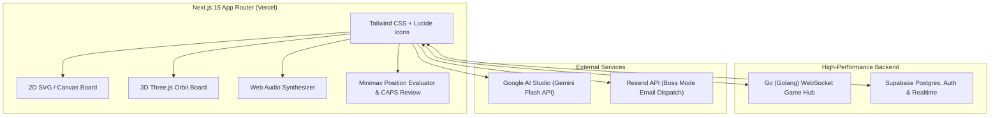

# ♟️ VibeChess - Grandmaster Chess Platform

> A lightning-fast, feature-packed modern chess web application with AI celebrity banter, 3D interactive boards, dual-screen pass & play, live game review, and high-concurrency multiplayer.

[](https://github.com/AyushShakya0/chess-app/actions)
[](https://nextjs.org/)
[](https://react.dev/)
[](https://tailwindcss.com/)
[](https://golang.org/)
[](https://supabase.com/)
[](https://aistudio.google.com/)

---

## 🌟 Key Features

### 1. 🎮 Pro 2D & 3D Interactive Chessboards
- **Pro 2D Board**: Left-click drag & drop, single-click to move, magnetic legal piece snapping.
- **Gesture Engine**:
  - Right-click drag multi-color arrows (Orange standard, Green Shift+, Red Alt+, Blue Ctrl+).
  - Right-click square threat highlights.
  - Left-click clears all board annotations.
- **Premove System**: Multi-premove queue with right-click cancel and instant 0.0s execution upon turn receipt.
- **Interactive 3D Mode**: Toggle on-the-fly to a Three.js 3D board with orbit controls and full 360° perspective.
- **Audio Engine**: Rich Web Audio sound effects for moves, captures, checks, low-time clock ticking, and victory fanfare.

### 2. 🤖 AI Celebrity Bots with Gemini Banter
- Play against 4 custom AI personas with distinct playstyles and ELO levels:
  - **Noob Bot (250 ELO)** - Easy blunders & hilarious panic.
  - **Hustler (1200 ELO)** - Aggressive tactical traps & street banter.
  - **Hikaru (2500 ELO)** - Speed demon & blitz trash talk.
  - **Magnus (2850 ELO)** - Cold, calculating endgame perfection.
- **Google AI Studio (Gemini Flash API)** integration gives each bot live, context-aware trash-talk responding to checks, captures, blunders, and mates (with automatic offline fallback quips).

### 3. 👥 Pass & Play Dual-Screen & Auto-Flip
- **Dual-Board Split-Screen**: Simultaneous side-by-side view (White's perspective on the left, Black's on the right) with strict turn-locking.
- **Auto-Flip Mode**: Automatically rotates the board 180° after each move for single-device over-the-board play.

### 4. ⚔️ Boss Mode ("Challenge Ayush")
- Special arena to challenge Ayush Shakya directly!
- Enter your name, ELO, and a battle cry; clicking "Dispatch Challenge" triggers an automated alert hook directly to `shakyaayush82@gmail.com` with a one-click match invitation link.

### 5. 🧩 Training, Puzzles & Opening Academy
- **Puzzle Arena**: Curated tactical puzzles with instant move feedback, solve streaks, and hints.
- **Opening Explorer**: Deep ECO opening database (Ruy Lopez, Sicilian Defense, Queen's Gambit, King's Indian, etc.) with master move statistics and win-loss bars.
- **The Knight's Tour**: Solo mathematical challenge across 5x5, 6x6, 7x7, and 8x8 boards with move counters and timers.

### 6. 📊 Real-Time Evaluation & Full Game Review
- Instant client-side minimax position evaluation with depth search.
- **Chess.com-style Game Review Modal**:
  - CAPS accuracy score for White & Black.
  - Move grading: Brilliant, Great, Best, Excellent, Good, Book, Inaccuracy, Mistake, Blunder, Missed Win.
  - Move-by-move navigation with evaluation graphs.

### 7. 🌐 Realtime Online Multiplayer & Go Server
- Create a room and share a match link (`/play/[roomId]`).
- Clocks with low-time heartbeat warnings, in-game spectator-friendly chat, and rematch scoreboard.
- High-performance Go (Golang) game server (`server/main.go`) handling low-latency move validation and monotonic clock synchronization.

### 8. 💎 VIP Promo System
- Unlock full lifetime VIP access by entering promo code **`"chess"`** in the VIP modal.

---

## 🛠️ Tech Stack & Architecture



---

## 🚀 Getting Started

### Prerequisites
- **Node.js** >= 20 (Node 22 or 24 recommended)
- **Go** >= 1.22 (optional, for running the native Go multiplayer server)
- **Git**

### Installation

1. **Clone the repository:**
   ```bash
   git clone https://github.com/AyushShakya0/chess-app.git
   cd chess-app
   ```

2. **Install frontend dependencies:**
   ```bash
   npm install
   ```

3. **Configure Environment Variables:**
   ```bash
   cp .env.example .env.local
   ```
   Fill in your credentials in `.env.local`:
   ```ini
   GOOGLE_AI_STUDIO_API_KEY=your_gemini_api_key_here
   NEXT_PUBLIC_SUPABASE_URL=https://your-project.supabase.co
   NEXT_PUBLIC_SUPABASE_ANON_KEY=your_supabase_anon_key_here
   RESEND_API_KEY=optional_resend_api_key
   ```

4. **Run the Next.js development server:**
   ```bash
   npm run dev
   ```
   Open [http://localhost:3000](http://localhost:3000) in your browser.

5. **(Optional) Start the Go Game Server:**
   ```bash
   cd server
   go run main.go
   ```
   The Go server will start listening on `http://localhost:8080`.

---

## 🧪 Testing & Validation

Run the automated test suite:
```bash
npm test
```

Run TypeScript static typecheck:
```bash
npx tsc --noEmit
```

Build the production bundle:
```bash
npm run build
```

---

## 📁 Repository Structure

```
├── app/
│   ├── api/
│   │   ├── ai/chat/            # Gemini Flash bot banter endpoint
│   │   └── boss/challenge/     # Boss Mode email dispatch endpoint
│   ├── play/[roomId]/          # Realtime multiplayer match room
│   ├── layout.tsx              # Root HTML & metadata layout
│   └── page.tsx                # Main dashboard & tab orchestrator
├── components/
│   ├── chess/
│   │   ├── board.tsx           # Interactive 2D chessboard & gesture engine
│   │   ├── board-3d.tsx        # Three.js 3D chessboard view
│   │   ├── ai-bots.tsx         # AI Celebrity bots play arena
│   │   ├── pass-and-play.tsx   # Dual-screen & auto-flip pass & play
│   │   ├── boss-mode.tsx       # Challenge Ayush boss arena
│   │   ├── knights-tour.tsx    # Knight's Tour solo puzzle
│   │   ├── variants-play.tsx   # 3-Check, Hidden Queen & Odds chess
│   │   ├── eval-bar.tsx        # Vertical position evaluation gauge
│   │   ├── game-review-modal.tsx# Post-game CAPS review dialog
│   │   └── pieces.tsx          # SVG chess pieces library
│   ├── learn/
│   │   └── opening-explorer.tsx# ECO opening book explorer
│   ├── navigation/
│   │   └── navbar.tsx          # Top navigation & theme toggles
│   ├── promo/
│   │   └── promo-modal.tsx     # VIP promo code modal ("chess")
│   └── puzzles/
│       └── puzzle-arena.tsx    # Tactical puzzle trainer
├── lib/
│   ├── audio/sound.ts          # Synthesized Web Audio sound effects
│   ├── engine/evaluator.ts     # Minimax evaluation & CAPS analysis engine
│   └── supabase/client.ts      # Supabase client initialization
├── server/
│   ├── go.mod                  # Go module definition
│   └── main.go                 # Go high-concurrency game server
├── supabase/
│   └── migrations/             # Postgres schema & RLS policies
├── tests/                      # Automated unit test suite
└── .github/
    └── workflows/ci.yml        # GitHub Actions CI workflow
```

---

## 🚢 Deployment Guide

### Deploying Frontend to Vercel
1. Push your code to GitHub.
2. Import the repository in [Vercel](https://vercel.com).
3. Set the environment variables (`GOOGLE_AI_STUDIO_API_KEY`, `NEXT_PUBLIC_SUPABASE_URL`, etc.).
4. Click **Deploy**.

### Deploying Go Server (Cloud Run / Railway / Fly.io)
The Go server in `server/main.go` compiles into a standalone binary with zero external runtime dependencies.
```dockerfile
FROM golang:1.22-alpine AS builder
WORKDIR /app
COPY server/ .
RUN go build -o server .

FROM alpine:latest
WORKDIR /root/
COPY --from=builder /app/server .
EXPOSE 8080
CMD ["./server"]
```

---

## 👤 Author & Credits

- **Creator & Lead Developer:** Ayush Shakya ([@AyushShakya0](https://github.com/AyushShakya0))
- **Email:** `shakyaayush82@gmail.com`
- **License:** MIT
