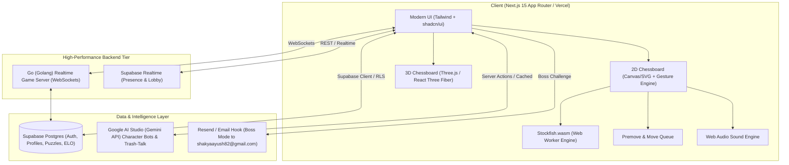
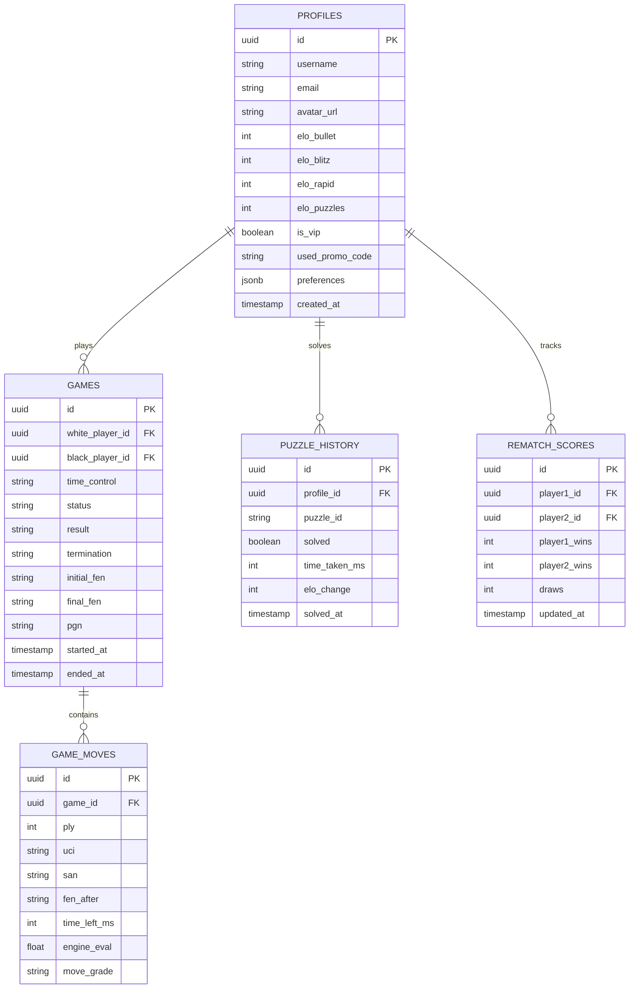
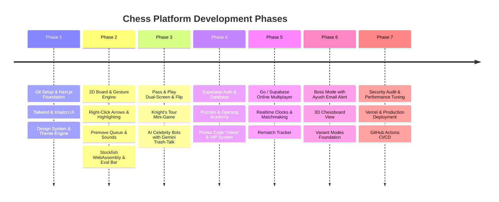

# ♟️ Master Architecture & Implementation Plan: Grandmaster Chess Platform

> **Target Deployment:** Vercel (Next.js Frontend & Edge API) + Supabase (Auth, Postgres, Realtime, Storage) + Go Server (High-concurrency WebSocket game/engine hub)  
> **Target GitHub Repository:** `AyushShakya0/chess-app` (Branching Strategy: feature branches -> `develop` -> `main`)  
> **Key Integrations:** Google AI Studio (Gemini 2.5/Flash API), Stockfish.wasm (Local zero-latency engine), Web Audio API, Resend / Supabase Edge Functions (Boss Mode notifications).

---

## 1. Executive Summary & Architecture Overview

This platform is designed to be a modern, lightning-fast, and feature-complete alternative to Chess.com and Lichess. It combines:
1. **Next.js 15 (App Router, React 19, Tailwind CSS, shadcn/ui)** for an ultra-responsive, beautiful web app.
2. **Interactive 2D & 3D Chessboards** with full gesture controls (right-click arrows, colored square markers, premove queue, drag-and-drop, and Three.js 3D board).
3. **Go (Golang) Game Server + Supabase Realtime** for authoritative move validation, low-latency clock synchronization, and cheat prevention.
4. **Local Stockfish 16+ (via WebAssembly & Web Workers)** for instant, zero-server-cost evaluation, accuracy scoring, and game review.
5. **Google AI Studio (Gemini Flash API)** powering custom-styled AI characters (Hikaru, Magnus, Hustler, Noob) with live trash-talk and conversational coaching—optimized for free tier rate limits.
6. **Unique Game Modes & Training:** Pass & Play (Flip vs. Dual-Board Split-Screen), Boss Mode (Email challenge to `shakyaayush82@gmail.com`), Knight's Tour mini-game, Opening Academy, and Variant playground.
7. **Monetization & VIP Promo System:** Freemium features with promo code bypass (`"chess"` unlocks 100% VIP access for free).



---

## 2. Comprehensive Feature Breakdown

### A. Core Chessboard & Gameplay Mechanics (Chess.com Parity)
- **Controls & Gestures:**
  - Left-click drag & drop + single-click source, single-click destination.
  - **Right-Click Drag Multi-Color Arrows:**
    - Standard Right-Click: Yellow / Orange arrow.
    - Shift + Right-Click: Green arrow (defensive / best paths).
    - Alt + Right-Click: Red arrow (threats / attacking lines).
    - Ctrl + Right-Click: Blue arrow (alternative lines).
  - **Right-Click Square Highlights:** Paint squares with colored overlays (matching modifier keys) for threat assessment.
  - Clear board annotations on left-click anywhere.
  - Ghost piece origin indicator during drag + magnetic legal snap.
- **Premove System:**
  - Single and **Multi-Premove Queueing** (up to 3 sequential premoves with translucent path trail).
  - Right-click cancels queued premoves immediately.
  - Instant 0.0s execution upon receiving the opponent's move (if legally valid).
- **Time Controls & Clocks:**
  - **Bullet:** 1|0, 1|1, 2|1.
  - **Blitz:** 3|0, 3|2, 5|0, 5|3.
  - **Rapid:** 10|0, 15|10, 30|0.
  - **Custom Clocks:** Any base time + increment.
  - **Low-Time Urgency:** Visual red clock pulsing + heartbeat audio cue when < 10 seconds.
- **Assists, View Modes & Settings:**
  - **Focus / Zen Mode (Press 'Z'):** Minimalist mode hiding chat, sidebars, and ratings for 100% board focus.
  - **Blindfold Mode:** Option to hide pieces or replace them with discreet dots for mental calculation training.
  - Show legal move dots / capture rings.
  - Highlight last move & King check indicator.
  - Auto-promote to Queen (toggleable: if off, pop up under-promotion selector: Queen, Rook, Bishop, Knight).
  - Confirm Resignation / Confirm Draw offer dialogs (with draw spam cooldown).
  - Move notation log (SAN notation, algebraic notation export, PGN export/import, FEN copy, animated GIF export).

### B. Visual Customization & Themes
- **Board Themes:**
  - Walnut & Maple Wood, Midnight Glass Obsidian, Cyberpunk Neon, Classic Emerald Green, Marble Slate, Tournament Black & White.
- **Piece Sets:**
  - Neo, Alpha, Classic Staunton, Pixel 8-bit, Fantasy, Modern Minimalist, Wood Carved.
- **App Themes:**
  - Dark Mode (OLED pitch black), Deep Charcoal, Modern Slate, Classic Light.
- **3D Chess Mode:**
  - Toggle between 2D high-performance canvas and full 3D interactive view (Three.js / React Three Fiber).
  - Realistic wooden/marble reflections, dynamic camera rotation, zoom, tilt, and piece-sliding animations.

### C. Game Modes

#### 1. AI Bots & Celebrity Personas
- **ELO-Based Bots:**
  - 250 (Beginner - random legal moves, frequent blunders).
  - 800 (Casual - basic tactical vision).
  - 1200 (Intermediate - captures hanging pieces, misses deep tactics).
  - 1600 (Advanced - solid opening principles, good endgame).
  - 2000 (Expert - sharp tactics, punishes mistakes).
  - 2600+ (Grandmaster - Stockfish depth 18+).
- **Character / Celebrity Personas:**
  - **"Hikaru-Style":** Fast, aggressive, premoves frequently, streams banter ("literally takes takes takes", "this guy is a genius").
  - **"Magnus-Style":** Calm, positional, grinding endgame quotes, dry humor.
  - **"Gotham-Style":** Dramatic commentary ("AND HE SACRIFICES... THE ROOOOOK!").
  - **"The Hustler":** Street chess trash-talk, hyper-confident gambits.
  - **"Cat Bot / Noob":** Cute, blunders all pieces, hilarious confusion in chat.
- **AI Trash-Talk & Chat Engine (Google AI Studio Gemini API):**
  - Character bots interactively chat during games.
  - **Free Tier Optimization:** Event-driven throttling (only triggers on significant events like blunders, queen sacrifices, checks, low time), client-side cache of common reactions, and fallback canned responses if rate-limited (HTTP 429 prevention).

#### 2. Pass & Play Mode (Local Two-Player)
- **Mode A: Auto-Flip Board:** Board dynamically rotates 180° after each move so the current player always looks from their own perspective.
- **Mode B: Dual-Board Simultaneous Split-Screen (Custom Innovation):**
  - Left half of screen displays White's perspective; Right half displays Black's perspective.
  - Touch/Mouse input is restricted: When it is White's turn, only the Left Board responds to interaction; when it is Black's turn, only the Right Board responds.
  - Perfect for tablet/touch laptops sitting between two players or desktop face-to-face play.

#### 3. Online Multiplayer
- **Lobby & Room Generation:** Instant shareable link (`/play/[roomId]`) or 6-digit room code.
- **Game Clock Synchronization:** Server-authoritative monotonically increasing clocks with RTT latency compensation to eliminate network lag penalty.
- **Spectator Mode:** Real-time broadcast for observers with live evaluation bar and viewer chat.
- **In-Game Chat:** Interactive chat box with emojis and sound notifications.
- **Rematch Score Tracking:** Persistent session tally (e.g. Player A: 3 | Player B: 1 | Draws: 2) across continuous rematches.

#### 4. Boss Mode ("Challenge Ayush")
- Dedicated Boss Arena screen with dramatic "Final Boss" orchestral music and visual effects.
- Clicking **"Challenge Boss Ayush"**:
  - Automatically triggers an email notification to `shakyaayush82@gmail.com` with the game join link and challenger info.
  - Enters a high-stakes waiting lounge with "Summoning Boss Ayush..." animation.
  - Custom Boss Badge, personalized boss dialog, and persistent win/loss tracker against Ayush.

#### 5. Variant & Mini-Game Modes (Phase 1 & Future Expansion)
- **The Knight's Tour (Solo Mini-Game - Available at launch):**
  - Select board size: **5x5, 6x6, 7x7, 8x8**.
  - Objective: Move the knight to visit every square on the board exactly once without repeating squares.
  - Features move counter, visited square trail, timer, undo/reset, and global leaderboard.
- **The Hidden Queen (Pass & Play / vs Bot):**
  - Each player secretly designates one of their pawns as the "Hidden Queen" before the match begins.
  - The pawn moves like a normal pawn until the player chooses to "reveal" it or until it captures/is captured, transforming into a Queen.
  - In Pass & Play: Secret selection screen with memory verification.
- **Handicap / Odds Mode:**
  - Play with material odds: Remove Queen, Rook, Knight, or multiple pieces.
  - Asymmetric play: Give one player two Queens, or extra pawns.
- **3-Check Chess (Variant):**
  - Traditional rules apply, but the first player to deliver 3 checks wins the game immediately. Check counter displayed beside player clock.
- **Custom Back-Rank (Piece Setup / Fischer Random 960 Variant):**
  - Drag-and-drop your starting pieces on the back rank according to your custom strategy before game start.
- **4-Player Chess (Roadmap Architectural Hook):**
  - Extended 14x14 cross board with 4 armies (Red, Blue, Yellow, Green), clockwise turn rotation.

---

### E. Analysis, "Game Review" & Live "Fun Analysis"
- **Stockfish.wasm Web Worker Analysis (Zero Cloud Cost):**
  - Runs 100% on the client browser—high-depth calculation with zero server latency.
  - Live Evaluation Bar (+/- decimal score or `#M` for mate).
  - **Chess.com-Grade Move Classification Badges:**
    - 💎 **Brilliant (`!!`)** — Sacrificial move that cements a winning advantage.
    - 🌟 **Great Move (`!`)** — The only holding or winning move in a sharp position.
    - 🟢 **Best Move (`★`)** — Optimal Stockfish line.
    - 🟩 **Excellent (`✓`)** — Strong positional move.
    - 🟦 **Good (`✓`)** — Solid standard continuation.
    - 📖 **Book Move (`📖`)** — Theoretical opening knowledge.
    - 🟡 **Inaccuracy (`?!`)** — Slight evaluation dip (0.5 – 1.0).
    - 🟠 **Mistake (`?`)** — Noticeable evaluation drop (1.0 – 2.5).
    - 🔴 **Blunder (`??`)** — Critical tactical blunder (> 2.5 drop or hung piece).
    - ❌ **Missed Win (`X`)** — Missed checkmate or game-winning tactic.
  - **Estimated Performance Rating (CAPS Score):** Accuracy % (e.g. 92.4%) & estimated player performance rating (e.g. "Played like an 1850").
  - **"Show the Threat" Tool:** Animated arrows revealing opponent's tactical threats after mistakes.
  - **Interactive "Retry Mistakes":** Key moments navigator allowing players to re-try blundered positions with dynamic hints.
- **Live "Fun Analysis" Mode:**
  - In-game evaluation bar and engine score revealed **every 5 moves** (Move 5, 10, 15, 20...).
  - Audio stings indicating massive evaluation swings without providing continuous engine assistance.

---

### F. Puzzles, Academy & Training Tools
- **Puzzles Engine:**
  - Pull puzzles from the curated open-source Lichess puzzle database (over 3M+ puzzles).
  - Categorized by themes: Pin, Fork, Skewer, Back Rank, Mate in 1/2/3, Endgame, Opening Traps.
  - Daily Puzzle with streak tracker & Puzzle Rush / Survival mode.
- **Puzzle Battle / Puzzle Racer:**
  - Real-time 3-minute multiplayer sprint where players race head-to-head to solve puzzles with real-time progress bars.
- **Vision Trainer (Board Coordinates):**
  - 30-second speed challenge prompting squares (e.g., "e4", "c6", "g7") to build instantaneous board coordinate fluency.
- **Interactive Board Editor & FEN Setup:**
  - Drag and drop pieces on an empty canvas to recreate any position, then launch into Analysis or "Play vs AI from this position".
- **Opening Explorer:**
  - Interactive opening tree with move frequency, master win rates, and popular continuations.
- **Interactive "Learn to Play" Tutorials & Strategy Blog:**
  - Interactive exercises for beginners, piece movement drills, and rich strategy articles.

---

### F. VIP Monetization & Promo Code System
- **Freemium Tier:**
  - Free access to Standard Play, Pass & Play, basic bots, 5 daily puzzles, and standard analysis.
- **VIP Tier (Premium):**
  - Unlimited puzzles, Puzzle Rush, celebrity bots, deep engine analysis, full opening explorer, and all board/piece themes.
- **Promo Code Bypass (`"chess"`):**
  - Dedicated promo redemption modal in the navbar and checkout page.
  - Entering promo code `chess` instantly unlocks VIP status permanently across the app.
  - Stored in Supabase user profile (`is_vip: true`) and synced with local storage for anonymous players.

---

## 3. Technology Stack & Directory Structure

```
c:\Vibe Projects\Chess\
├── apps/
│   └── web/                               # Next.js 15 Full-Stack Application
│       ├── app/
│       │   ├── (auth)/                    # Sign-in, Sign-up, Forgot-password
│       │   ├── (game)/
│       │   │   ├── play/                  # Play lobby (Time controls, mode picker)
│       │   │   │   ├── [roomId]/          # Online multiplayer room
│       │   │   │   └── bots/              # Bot selection & play arena
│       │   │   ├── pass-and-play/         # Dual-screen & Flip Pass-and-Play
│       │   │   ├── boss-mode/             # "Challenge Ayush" Epic Arena
│       │   │   ├── mini-games/            # Knight's Tour, Variants
│       │   │   └── analysis/              # Game review & PGN importer
│       │   ├── puzzles/                   # Daily puzzle & Puzzle Rush
│       │   ├── learn/                     # Tutorials & Opening Explorer
│       │   ├── blog/                      # Strategy articles & guides
│       │   ├── api/
│       │   │   ├── ai/chat/               # Gemini API proxy (rate-limited & throttled)
│       │   │   ├── boss/challenge/        # Email dispatcher for Ayush challenge
│       │   │   └── promo/redeem/          # Promo code engine ("chess" validator)
│       ├── components/
│       │   ├── chess/
│       │   │   ├── board-2d/              # Canvas/SVG 2D Board with arrows & highlights
│       │   │   ├── board-3d/              # Three.js / R3F 3D Chessboard
│       │   │   ├── eval-bar/              # Real-time evaluation bar
│       │   │   ├── move-list/             # Move notation panel & history
│       │   │   ├── clock/                 # Synchronized chess timer
│       │   │   └── promotion-modal/       # Under-promotion selection
│       │   ├── bot-chat/                  # In-game AI trash-talk interface
│       │   ├── split-screen/              # Dual-board pass-and-play controller
│       │   └── ui/                        # Radix UI / shadcn/ui components
│       ├── lib/
│       │   ├── chess/                     # chess.js wrapper, rules, FEN/PGN utilities
│       │   ├── engine/                    # Stockfish.wasm worker manager
│       │   ├── supabase/                  # Supabase client & server clients
│       │   ├── audio/                     # Sound effect synthesizer & audio player
│       │   └── gemini/                    # Gemini Flash prompts & bot personality matrices
│       └── public/
│           ├── pieces/                    # SVG & PNG piece sets (Neo, Alpha, Staunton...)
│           ├── sounds/                    # Move, capture, check, boss music audio files
│           ├── stockfish/                 # stockfish.js & stockfish.wasm binaries
│           └── models/                    # 3D GLTF chess piece models
├── services/
│   └── game-server/                       # Go (Golang) WebSocket Server (Optional / Scalable)
│       ├── cmd/server/main.go             # High-concurrency game server entry
│       ├── pkg/room/                      # Room management & matchmaking
│       ├── pkg/chess/                     # Authoritative move validation & clock tracker
│       └── pkg/ws/                        # WebSocket connection hub & lag compensation
├── supabase/
│   ├── migrations/                        # SQL schema migrations (RLS, tables, triggers)
│   └── functions/                         # Supabase Edge functions (Boss email, webhooks)
├── plan.md                                # This Master Plan
└── README.md                              # Project Documentation
```

---

## 4. Database Schema (Supabase Postgres)



---

## 5. Critical Engineering Safeguards, Bug Mitigations & Security

### 1. Clock Tampering, Anti-Cheat & Fair Play
- **Risk:** Malicious clients altering clock values or using external engines.
- **Server Monotonic Clocks:** Go server/Supabase maintains authoritative monotonic timestamps (`time.Now()`). Client clocks strictly interpolate.
- **Fair Play & AFK Rules:**
  - **Game Abort Grace:** If White plays no move within 20s or Black on move 1, abort with zero rating penalty.
  - **Auto-Abandonment Countdown:** If a player disconnects or idles for > 45s (or > 50% remaining time), the opponent can claim victory.
  - **Draw Cooldown:** Prevents draw offer spamming (10 moves / 60s cooldown).
  - **Session Recovery:** Reconnection grace period (60s) with seamless state recovery via session tokens.
- **Engine Correlation Flagging:** Flag accounts exhibiting > 98% correlation with Stockfish depth 22 over multiple games with robotic, uniform move intervals.
- **Move Validation:** Dual-stage validation: Client runs `chess.js` for instant feedback; Server validates the move against the server-side game state before broadcasting.

### 2. Google AI Studio (Gemini API) Free Tier Quota Protection
- **Risk:** Free API keys have strict Requests Per Minute (RPM) and Tokens Per Minute (TPM) limits. Rapid moves could trigger HTTP 429 errors.
- **Mitigation Strategy:**
  1. **Event Filtering:** Bots only consider speaking on significant events:
     - Blunder detected (Evaluation swing > 2.0).
     - Major piece sacrificed / captured (Queen, Rook).
     - King checked or checkmated.
     - Low time (< 15 seconds remaining).
  2. **Throttling & Cooldown:** Enforce a minimum 12-second cooldown between AI remarks.
  3. **Context Truncation:** Send only the last 6 plies (3 moves) of PGN instead of the entire match to conserve token usage.
  4. **Graceful Fallback:** If the Gemini API returns a 429 or timeout, automatically pick from a pre-compiled JSON catalog of 500+ character-specific witty lines. The user experience is 100% seamless.

### 3. State Synchronization & Lag Compensation
- **Risk:** High latency players losing games due to network transit delay.
- **Mitigation:** Implement WebSocket heartbeat ping/pong (every 5 seconds) to measure round-trip time (RTT). Half of RTT (one-way delay, capped at 250ms) is credited back to the player's clock on move arrival.

### 4. Row Level Security (RLS) & Promo Code Exploitation
- **Supabase RLS:**
  - Games and user profiles are strictly protected. Users can only edit their own profile settings.
  - Promo code verification is handled server-side via Supabase Edge Function or Next.js server action with rate limiting to prevent brute-force attacks.

### 5. Memory & Performance with Stockfish.wasm
- **Mitigation:** Stockfish runs in a dedicated background `Web Worker`. Thread count and hash size are capped (max 16MB hash for browser stability) to ensure 60fps animations even on mobile devices.

---

## 6. Phased Implementation Roadmap



### Phase 1: Repository Setup & Core UI Foundation
- Initialize Git repository and setup `develop` and feature branches.
- Scaffold Next.js 15 (App Router, Tailwind CSS, Lucide icons, shadcn/ui).
- Establish theme provider (Dark, OLED, Light, Board themes, Piece set selector).

### Phase 2: Professional 2D Chessboard & Local Engine
- Implement high-performance 2D board with:
  - Drag-and-drop & click-to-move.
  - Right-click multi-color arrows and square coloring engine.
  - Premove queue mechanism with right-click cancel.
  - Web Audio sound effects (move, capture, check, castle, illegal, game end).
- Integrate `chess.js` for legal move validation and SAN/PGN/FEN generation.
- Integrate `stockfish.wasm` in Web Worker for real-time evaluation bar (+/- score) and post-game accuracy scoring.

### Phase 3: Pass & Play, Mini-Games & AI Bots
- Implement Pass & Play:
  - Auto-flip mode.
  - **Dual-Board Simultaneous Split-Screen** (Left: White view, Right: Black view with turn-lock).
- Implement **The Knight's Tour** solo mini-game (5x5, 6x6, 7x7, 8x8 boards with move counter and timer).
- Implement AI Bots (ELO 250 to 2600+) with celebrity personalities (Hikaru, Magnus, Hustler, Noob).
- Integrate Google AI Studio (Gemini Flash API) for interactive in-game chat and trash-talk with free-tier rate limit protection and canned fallback quips.

### Phase 4: Supabase Backend, Puzzles & Monetization
- Setup Supabase project (Postgres, Auth, Storage).
- Build Puzzles module: Lichess puzzle importer, daily puzzle, rating calculator.
- Build Opening Explorer & "Learn to Play" beginner guides.
- Implement VIP system with promo code modal: code `"chess"` grants instant, permanent full access.

### Phase 5: Online Multiplayer & Go Game Server
- Build lobby system: Create room, join with code/link (`/play/[roomId]`), spectator view.
- Real-time game engine: Authoritative move validation, latency-compensated clocks.
- Session rematch tracking (W - D - L scoreboard).
- In-game chat and emoji reactions.

### Phase 6: Boss Mode, 3D Chess & Variants
- **Boss Mode ("Challenge Ayush"):**
  - Dedicated Boss UI arena with dramatic audio.
  - Automated email challenge to `shakyaayush82@gmail.com` with one-click match link.
- **3D Chess Mode:**
  - Interactive 3D board with Three.js (React Three Fiber), orbit controls, and realistic materials.
- **Variant Modes Architecture:**
  - 3-Check Chess, The Hidden Queen, Handicap / Odds chess, and Custom Back-Rank.

### Phase 7: Quality Assurance, Security Audit & Deployment
- Comprehensive testing (move validation edge cases, premove cancellations, clock drift tests).
- Cross-device responsive optimization (Desktop, iPad/Tablet split-screen, Mobile).
- Setup GitHub Actions CI/CD to repository `AyushShakya0/chess-app`.
- Deploy Next.js frontend to Vercel and Go game service to cloud hosting.

---

## 7. Git Workflow & Version Control Standard

To strictly honor the user's instructions:
1. **Never push directly to `main`**.
2. Work will be developed in structured feature branches:
   - `develop` (Integration branch)
   - `feature/board-and-engine`
   - `feature/pass-and-play-and-minigames`
   - `feature/ai-bots-gemini`
   - `feature/online-multiplayer-go`
   - `feature/boss-mode-and-vip`
3. Commits will follow Conventional Commits standard (`feat:`, `fix:`, `docs:`, `perf:`).
4. Pull Requests or explicit merges into `main` only after full verification.

