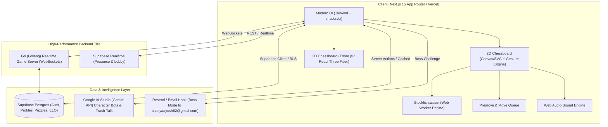
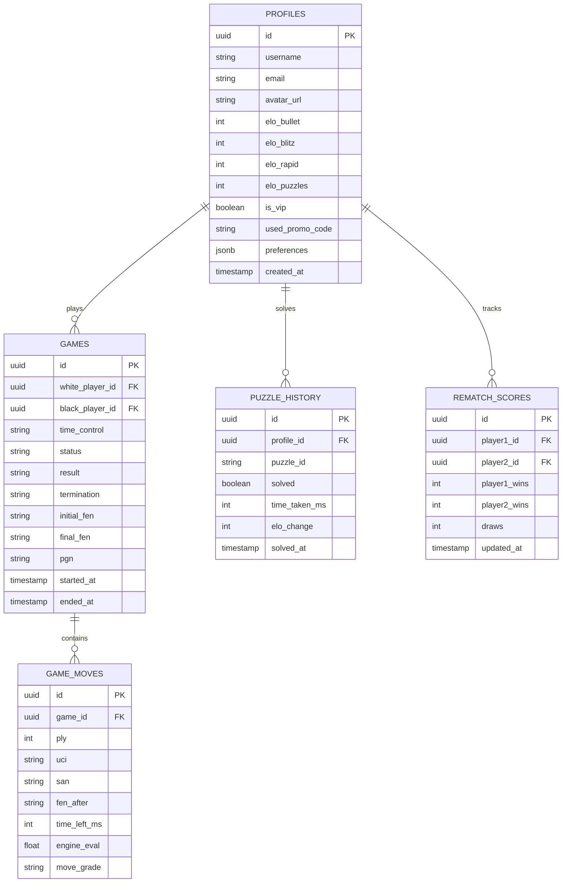
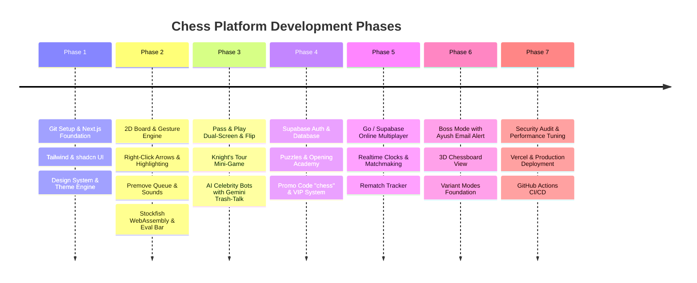

# ♟️ Master Architecture & Implementation Plan: Grandmaster Chess Platform

> **Target Deployment:** Vercel (Next.js Frontend & Edge API) + Supabase (Auth, Postgres, Realtime, Storage) + Go Server (High-concurrency WebSocket game/engine hub)  
> **Target GitHub Repository:** `AyushShakya0/chess-app` (Branching Strategy: feature branches -> `develop` -> `main`)  
> **Key Integrations:** Google AI Studio (Gemini 2.5/Flash API), Stockfish.wasm (Local zero-latency engine), Web Audio API, Resend / Supabase Edge Functions (Boss Mode notifications).

---

## 0. Project Audit & Current Status (updated 2026-11-16)

> Audit of `develop` @ `2167dbb`. Verified: `npx tsc --noEmit` clean, `npm test` 15/15 pass, `npm run build` succeeds (home route first-load JS **324 kB**). Codebase ≈ 10k lines TS/TSX + 1 Go file.
>
> Sections 1–7 below describe the **target** product. This section records what actually exists, what is broken, and the order in which to fix it. Work the backlog in §0.9 before starting new features from §2.

### 0.1 Plan vs. Reality

| Area | What exists today | Status |
|---|---|---|
| 2D board & gestures | Click/drag moves, right-click arrows & highlights, single premove. No multi-premove queue, no touch drag, under-promotion broken (§0.2 #2) | 🟡 Partial |
| Themes | 4 board themes, 1 piece set, dark UI only | 🟡 Partial |
| 3D board | Renders a fixed starting position; not connected to any game | 🟠 Demo only |
| Engine | Custom minimax in `lib/engine/evaluator.ts`, **on the main thread**. No Stockfish, no Web Worker, no WASM | 🟠 Substitute |
| AI bots + Gemini | 5 personas, `/api/ai/chat` with multi-key failover + canned fallback lines | 🟢 Done (bugs) |
| Game review | `game-review-modal.tsx` exists but is **never rendered**; grades come from 1-ply static eval | 🔴 Unreachable |
| Pass & Play | Dual board, flip, Hidden Queen, 3-Check, odds | 🟢 Done (bugs) |
| Online multiplayer | `/play/[roomId]` is a **local single-device board**; chat is local; frontend never calls the Go server; no WebSockets | 🔴 Mock only |
| Go server | HTTP create/move endpoints; trusts client FEN; no validation, auth or WebSockets | 🔴 Prototype |
| Boss Mode | Resend email + mailto fallback works; invite link opens the local mock room | 🟡 Partial |
| Knight's Tour | Done; no leaderboard | 🟢 Done |
| Puzzles | 37 curated puzzles + streak in localStorage; no Lichess DB, no rating | 🟡 Partial |
| Openings & Courses | 18 deep variations, courses hub with filters | 🟢 Done |
| Supabase | Client created but **never imported**; migration not applied anywhere; no auth | 🔴 Not started |
| VIP / promo | localStorage flag set by client-side check of `"chess"`; **nothing is gated** | 🟠 Cosmetic |
| CI | Typecheck, tests, Next build, `go build`. No lint despite job name | 🟡 Partial |

### 0.2 Correctness Bugs (fix first)

1. **Bot games lose their move history after every bot move.** `components/chess/ai-bots.tsx:269` does `setGame(new Chess(currentGame.fen()))`, and a FEN carries no history. Consequences:
   - `ChessEvaluator.getBookMove` compares a 1–2 move "history" against opening lines that start at move 1, so 2000+ ELO bots can play "book" replies in the middlegame whenever the SAN happens to be legal.
   - Threefold repetition is never detected in bot games.
   - Fun eval mode ("reveal every 5 moves", `ai-bots.tsx:170`) never fires because history length never reaches 5.
   - Gemini gets ≤ 2 moves of context; any PGN export/review would be wrong.
   - Same pattern after Hidden Queen moves: `pass-and-play.tsx:237`, `:268`.
   - **Fix:** never rebuild `Chess` from FEN just to trigger a re-render. Keep one instance and bump a version counter, or clone with `loadPgn(game.pgn())`. See the `useChessGame` hook in §0.4.
2. **The under-promotion picker never makes the move.** The picker button (`components/chess/board.tsx:530`) calls `attemptMove`, which re-enters the promotion branch (`board.tsx:136`) and returns `true` without moving. It is hidden today only because `autoQueen` is hard-coded to `true` (`pass-and-play.tsx:129`) and no other mode passes the prop, so **under-promotion is impossible everywhere**. The picker also opens for illegal pawn moves to the back rank because legality isn't checked first.
3. **Hidden Queen corrupts the board on the back rank.** `executeQueenMove` (`pass-and-play.tsx:94`) calls `remove`/`put` before `game.load`. chess.js rejects pawns on ranks 1/8 (`Invalid FEN: some pawns are on the edge rows`, verified), so a queen move to rank 1/8 throws after the board was already mutated. The throw is not caught (`board.tsx:142` sits outside the `try`). Related rule gaps:
   - No self-check test: a queen move can leave your own king in check.
   - chess.js thinks the disguised piece is a pawn, so checks, mates and the opponent's legal king moves ignore its queen attacks.
   - An en-passant capture of a secret pawn isn't detected (`pass-and-play.tsx:295` only checks `move.to`).
4. **Clocks lose time.** In `app/play/[roomId]/page.tsx` and `pass-and-play.tsx:161`, a 1-second `setInterval` restarts on every turn change (`game.turn()` is in the deps). Any move made in under 1 s costs nothing, and the leftover fraction of each second is dropped. Timeout side effects (sound, score) also run inside `setState` updaters, which StrictMode calls twice in dev, so the score goes up by 2.
   - **Fix:** a `useChessClock` hook that stores the deadline as a `performance.now()` timestamp, derives remaining time, supports increment, and fires side effects from an effect.
5. **The bot search freezes the UI.** Magnus (depth 7 in endgames) and Hikaru (depth 6) search synchronously on the main thread with no time limit (`ai-bots.tsx:245`). The eval bar also runs a depth-2 search on the main thread after every move (`ai-bots.tsx:192`).
6. **Engine and review quality.**
   - Mate scores ignore distance, so a bot may not pick the fastest mate.
   - Forward pruning at depth ≤ 2 keeps only 5 quiet moves (`evaluator.ts:353`), which misses quiet defences and mates.
   - No king-safety or endgame tables.
   - `analyzeFullGame` grades each move by the 1-ply static-eval change, so normal trades look like "brilliant" then "blunder". "Book" just means the first 4 plies.
7. **Online room is single-player.** Both colours are playable from one browser. The "You (White)" label and clock positions stay fixed when the view flips, and chat never leaves the page.
8. **The 3D toggle shows a new game, not the current one** (`app/page.tsx:18`; `setDemoGame` is never used).
9. **Premove gaps.** No legal-move dots while premoving (`game.moves()` returns `[]` for the side not to move), only one premove (the plan says up to 3), and a failed premove plays the normal move sound.

### 0.3 Security Findings

1. **`/api/boss/challenge` is an open email relay into the owner's inbox.**
   - Public, no auth, no rate limit: anyone can spam the inbox through the project's Resend account.
   - `challengerName`, `challengerElo` and `message` go **unescaped into the email HTML**, so an attacker can inject HTML and links into mail sent from your sender.
   - No type or length validation.
   - The recipient address is hard-coded in source; move it to a `BOSS_EMAIL` env var.
2. **`/api/ai/chat` trusts all input.**
   - `botName`, `event`, `pgn` and `lastMove` are pasted straight into the prompt: prompt injection and unbounded token use. The route is effectively an open Gemini proxy.
   - The 2-second "global" cooldown lives in module memory: it is per serverless instance, shared by all users (one user's traffic silences everyone else), and doesn't stop abuse across instances.
   - No timeout on the model call. The response exposes `keyIndex`.
   - **Fix:** allowlist `botName`; cap field lengths; restrict `pgn`/`lastMove` to SAN characters; per-IP rate limit (Vercel KV/Upstash or a Supabase table); `AbortSignal.timeout(~4000)`.
3. **Supabase RLS holes** (`supabase/migrations/01_initial_schema.sql`), which matter as soon as auth goes live:
   - The "Users can update their own profile" policy lets a user set their own `is_vip`, `elo_*` and `used_promo_code`. Restrict the updatable columns, or route those writes through a `security definer` RPC.
   - The `games` UPDATE policy lets either player rewrite `result` and `pgn`. Results must be written by the server (service role) only.
   - No trigger creates a `profiles` row on signup. The `game_moves` table from §4 is missing. No indexes on foreign-key columns.
4. **Go server** (`server/main.go`):
   - `Access-Control-Allow-Origin: *`, no player identity: anyone can move for either colour.
   - Accepts client FEN/SAN without validation, contradicting §5.1.
   - Rooms are never deleted (memory grows without bound).
   - Room IDs are `room-<nanos % 1e6>`, which collide and are guessable.
   - No body-size limit, no graceful shutdown.
5. **Promo code** is checked in the browser, and the error message hints the answer ("Hint: Try code 'chess'"). That's fine for an easter egg, but must move server-side if VIP ever gates anything real.

### 0.4 Architecture & Code Health

- **No single owner of game state.** Seven components each create `Chess` instances, play sounds, detect mate/draw and run clocks. `Chessboard` mutates its `game` prop in place (`board.tsx:154`) while parents also replace it. This is the root cause of bugs #1, #3 and #4.
  - Extract `lib/chess/use-chess-game.ts`: owns the instance and exposes `move()`, `undo()`, `history`, `pgn`, `status` (mate/draw/threefold/timeout), sound triggers and a version counter.
  - Extract `lib/chess/use-chess-clock.ts`.
  - Make `Chessboard` controlled: it proposes moves through `onMove` and never mutates props.
- **One client page for everything.** `app/page.tsx` is `"use client"` and switches tabs in state. There are no URLs per mode (no deep links, back button or sharing), and every mode plus Three.js ships in one 324 kB bundle.
  - Move modes to routes (`/bots`, `/pass-and-play`, `/puzzles`, `/learn`, `/variants`, `/knights-tour`, `/boss`) under a shared layout with the navbar.
  - Load `Board3D` with `next/dynamic(..., { ssr: false })`.
- **Dead code:** `components/chess/game-review-modal.tsx` (never rendered), `components/chess/eval-bar.tsx` (duplicate of `evaluation-bar.tsx`), `lib/supabase/client.ts` (never imported), and the `next.config.ts` webpack `asyncWebAssembly` + `serverActions` settings (there is no WASM and there are no server actions). Wire each one up or delete it.
- **Engine off the main thread.** Move `ChessEvaluator` into a Web Worker (`new Worker(new URL("./engine.worker.ts", import.meta.url))`) with iterative deepening and a time budget per bot. That fixes the freezes without new dependencies. Stockfish.wasm stays optional. Note that Stockfish is **GPL-3.0**: shipping it means offering its source and checking compatibility with the repo's MIT licence.
- **Gemini usage doesn't match §5.2.** `ai-bots.tsx:302` calls the API on every bot move, "normal move" included, with no 12-second client cooldown.
- **Settings are scattered.** Each component uses its own localStorage keys. There is no global settings store for sound (`SoundEngine.setEnabled` exists but nothing calls it), piece set, auto-queen, coordinates or eval mode.
- **Naming drift:** "Prin Chess" (UI/README), "VibeChess" (`.env.example`), "princhess" (Go), "chess-app" (package). Pick one.
- `@types/three` belongs in `devDependencies`.

### 0.5 UX & Accessibility

- **No ARIA attributes anywhere in the codebase.** Board squares are clickable `div`s: no keyboard play and no screen-reader move announcements. Modals have no `role="dialog"`, Escape handling or focus trap. Check, last move and legal moves are shown by colour only.
- **No touch drag.** HTML5 drag-and-drop doesn't fire on touch screens, so tablets (the main target for dual-board Pass & Play) can only tap-tap. Switch to pointer events.
- **No sound on/off or volume control** in the UI.

### 0.6 Testing & Tooling

- **Two test files test copies of the logic.** The suites cover chess.js and the data files well, but `tests/promo.test.ts` and `tests/secret-queen.test.ts` define their own copy of the logic inside the test file, so they can't catch regressions in the app. Extract the pure logic (`lib/variants/hidden-queen.ts`, `lib/promo.ts`) and import it from both places.
- **Untested:** board interaction, clocks, bot history/book selection, API routes, Go server.
- **No lint.** The CI job is called "Build, Lint & Test" but never lints. `npm run lint` uses the deprecated `next lint`, and ESLint isn't installed. Add an ESLint flat config with `eslint-config-next` and `react-hooks`; it would flag the stale-closure deps at `board.tsx:218` and the clock effects. Add `go vet` for the server.
- Every test file prints `MODULE_TYPELESS_PACKAGE_JSON` warnings.

### 0.7 Security Pass 2: Dependencies, Secrets, Headers, CI (2026-11-16)

**Checked and clean ✅**
- **Git history:** no API keys, Resend keys, JWTs or Supabase service keys in any commit on any branch (pattern scan of `git log --all -p`). Only `.env.example` was ever committed; `.env.local` is ignored and untracked.
- **No server secrets reach the client:** no `"use client"` file reads `process.env`; only the two `NEXT_PUBLIC_SUPABASE_*` values are public, which is intended for the anon key.
- **No `dangerouslySetInnerHTML`.** React escapes all rendered text (chat, names, war cry).
- **Untrusted JSON:** both localStorage reads (`courses-hub.tsx:48`, `puzzle-arena.tsx:113`) sit in `try/catch`.
- **`go vet`:** clean on `server/`.
- The Gemini key travels in a request header, not the URL, so the `console.warn` of error messages in `/api/ai/chat` doesn't leak it.

**New findings**

| # | Severity | Finding | Fix |
|---|---|---|---|
| S1 | High | **Boss email link can be steered.** `/api/boss/challenge` builds `inviteLink` from the client-supplied `roomId` and `req.nextUrl.origin` (derived from the Host header), then writes it **unescaped into an HTML `href`**. Attribute injection lets an attacker put arbitrary links and markup into mail sent as "Prin Chess Boss Arena". | Generate `roomId` on the server with `crypto.randomUUID()`; build links from a configured `APP_URL` env var; HTML-escape every interpolated value. |
| S2 | High (dev-time) | **`npm audit`: PostCSS ≤ 8.5.22 bundled inside `next@15.5.29`** (XSS in stringify output, source-map path traversal and file read: GHSA-qx2v-qp2m-jg93, GHSA-6g55-p6wh-862q, GHSA-fxqj-rqcc-2cmp, GHSA-r28c-9q8g-f849). Only exploitable by processing attacker-controlled CSS at build time, so real risk here is low. The only fix npm offers is `next@16`. | Track it; schedule the Next 16 upgrade (Milestone B). Don't run `npm audit fix --force` blindly; it's a major upgrade. |
| S3 | Medium | **No security headers.** No CSP, no `frame-ancestors`/`X-Frame-Options` (clickjacking), no `Referrer-Policy` (invite room IDs can leak through Referer), no `Permissions-Policy`, no `X-Content-Type-Options`. `X-Powered-By: Next.js` is sent. | Add `headers()` in `next.config.ts` with a CSP limited to `'self'` (connect to Supabase/Go host when they exist), `frame-ancestors 'none'`, `Referrer-Policy: strict-origin-when-cross-origin`, `nosniff`, and a `Permissions-Policy` that disables camera/mic/geolocation; set `poweredByHeader: false`. |
| S4 | Medium | **Config drift on the Boss recipient.** `.env.local` defines `BOSS_ALERT_EMAIL`, but the route ignores it and uses a hard-coded address; `.env.example` doesn't document it. Conversely, `NEXT_PUBLIC_GO_WS_SERVER_URL` is documented but read nowhere. | Read `BOSS_ALERT_EMAIL` (fail closed if missing); sync `.env.example` with what the code actually reads. |
| S5 | Medium | **Go server has no HTTP timeouts or body limit.** `http.ListenAndServe` with the default server is open to slow-client (Slowloris) connection exhaustion; request bodies are unbounded. The port is hard-coded to `:8080`, so cloud hosts that inject `PORT` won't work. | Use `http.Server{ReadHeaderTimeout, ReadTimeout, WriteTimeout, IdleTimeout}`, `http.MaxBytesReader`, `PORT` from env, an allowed-origins list instead of `*`, and graceful shutdown on SIGTERM. |
| S6 | Medium | **CI supply chain.** The workflow has no `permissions:` block, so `GITHUB_TOKEN` gets the repo's default (possibly write). Actions are pinned to moving tags (`@v4`, `@v5`). No dependency or vulnerability scanning. | Add `permissions: contents: read`; pin actions to commit SHAs; add `.github/dependabot.yml` (npm, gomod, github-actions); add `npm audit --omit=dev --audit-level=high` and `govulncheck` steps; optionally enable CodeQL. |
| S7 | Low | **Guessable IDs.** Room and boss IDs use `Math.random()` (6 base-36 chars, `boss-mode.tsx:97`); Go uses `nanos % 1e6`. Fine for a local mock, but once rooms are real, anyone who guesses an ID can join or spectate. | `crypto.randomUUID()` (browser and Node) / `crypto/rand` (Go), created server-side. |
| S8 | Low | **Silent Supabase misconfiguration.** `lib/supabase/client.ts` falls back to a placeholder URL and key, so a missing env var surfaces later as confusing network errors. | Throw at startup when the env vars are missing (after build-time placeholders are handled in CI). |
| S9 | Low | **Unchecked error responses.** `boss-mode.tsx:111` reads `res.json()` without checking `res.ok`, so a 500 shows "challenge sent" with an `undefined` invite link. It also uses `alert()` for errors. | Check `res.ok`, show the error inline. |
| S10 | Info | **Abuse budget.** Neither API route has rate limiting, so a script can burn the Gemini free-tier quota (denying banter to real players) and the Resend quota. | One shared per-IP limiter used by both routes (Vercel KV/Upstash, or a Supabase table once it exists). |

### 0.8 Other Improvements Found

- **Missing app basics:** no `public/` folder, so no favicon, app icons or Open Graph image. No `app/error.tsx`, `app/not-found.tsx` or `loading.tsx`, so any render error white-screens the whole app. No `viewport`/`themeColor` metadata. An error boundary around each mode would stop a crash in one mode (e.g. the Hidden Queen throw in §0.2 #3) from taking down the page.
- **Audio lifecycle:** the AudioContext in `SoundEngine` is created on first sound, which is fine, but nothing exposes mute or volume, and `boss-mode.tsx` creates a second, separate AudioContext for music. Use one engine for both.
- **Timers on unmount:** many `setTimeout` calls (bot move delay, announcements, "copied" flags) are never cleared, so switching tabs mid-bot-move can apply a bot move or set state on an unmounted or reset game (`ai-bots.tsx:211`, `:242`). The `useChessGame` hook should own and cancel pending bot moves.
- **Offline/PWA potential:** everything except Gemini and email already works client-side. A web manifest and service worker would make bots, puzzles, Pass & Play and courses work offline, which suits the tablet Pass & Play use case.
- **Persistence:** nothing survives a refresh mid-game. Saving the current PGN per mode in localStorage is cheap now and becomes Supabase-backed later.
- **Tooling:** add `"engines": { "node": ">=20" }` to `package.json` (the README says Node ≥ 20 and CI uses 22), plus an `.nvmrc`. Bump the `go.mod` directive from 1.22, which no longer gets security patches; CI should use the same version.

### 0.9 Prioritized Backlog

**Milestone A: Stabilize (bugs and security only, no new features) — ✅ COMPLETED**
1. [x] `useChessGame` hook + controlled `Chessboard`; fixes history loss (bug #1).
2. [x] Fix the promotion picker; add an auto-queen setting (bug #2).
3. [x] Hidden Queen: handle the back rank (promote the disguise on rank 1/8), reject self-check, detect en-passant capture; move the logic to `lib/variants/` with real tests (bug #3).
4. [x] `useChessClock` with timestamps and increment (bug #4).
5. [x] Engine in a Web Worker with a time budget; mate-distance scoring; remove the depth ≤ 2 quiet-move cap or raise it (bugs #5, #6).
6. [x] Harden both API routes: validation, HTML escaping, server-generated room IDs + `APP_URL`, one shared per-IP rate limiter, timeout, read `BOSS_ALERT_EMAIL` (§0.3 #1–2, §0.7 S1, S4, S9, S10).
7. [x] Security headers + `poweredByHeader: false` in `next.config.ts` (§0.7 S3).
8. [x] CI: `permissions: contents: read`, SHA-pinned actions, Dependabot, `npm audit` + `govulncheck` steps (§0.7 S6).
9. [x] Add `app/error.tsx`, `not-found.tsx` and per-mode error boundaries so a single mode can't white-screen the app (§0.8).

**Milestone B: Structure & Quality — ✅ COMPLETED**

10. [x] One route per mode; dynamic import for Three.js; wire up or delete the dead code; connect 3D view to the active game.
11. [x] ESLint + `react-hooks` in CI; replace copy-tests with tests that import app code; unit-test the new hooks.
12. [x] Accessibility pass (keyboard board, ARIA labels, dialog semantics) + pointer-event drag.
13. [x] Global settings store (sound, theme, piece set, auto-queen, eval mode, show coordinates).
14. [x] Clear PostCSS advisories; bump Go version to 1.23; add `engines`/`.nvmrc`.
15. [x] Persist in-progress games (PGN in localStorage); cancel pending bot-move timers on unmount/reset; single audio engine with mute/volume.
16. [x] Show the game review at game end (bots, Pass & Play), with search-based grading in the worker.

**Milestone C: Authoritative Backend & Multiplayer Infrastructure — ✅ COMPLETED**

17. [x] Authoritative transport: Next.js server-authoritative move validation with `chess.js`, server monotonic clocks, player identity per color (White vs. Black vs. Spectator), room expiry; Go server hardened with timeouts, body limit, PORT env, secure IDs, and cleanup ticker; live `/play/[roomId]` and `/online` lobby.
18. [x] Supabase Auth & Schema: corrected RLS holes on `profiles` and `games`, trigger on `auth.users`, added `game_moves` table, indexes on foreign keys, and `useAuth` session store with Auth modal.
19. [x] VIP entitlement: server-side redemption endpoint (`/api/vip/redeem`) with IP rate limiting, Postgres `redeem_vip_promo` RPC, and client hints removed.

**Milestone D: Planned features from §2**, after A–C: multi-premove queue, more themes and piece sets, Lichess puzzle import + puzzle rating, Knight's Tour leaderboard, spectators, optional Stockfish.

---

## 1. Executive Summary & Architecture Overview

This platform is designed to be a modern, lightning-fast, and feature-complete alternative to Chess.com and Lichess. It combines:
1. **Next.js 15 (App Router, React 19, Tailwind CSS, shadcn/ui)** for an ultra-responsive, beautiful web app.
2. **Interactive 2D & 3D Chessboards** with full gesture controls (right-click arrows, colored square markers, premove queue, drag-and-drop, and Three.js 3D board).
3. **Go (Golang) Game Server + Supabase Realtime** for authoritative move validation, low-latency clock synchronization, and cheat prevention.
4. **Local Stockfish 16+ (via WebAssembly & Web Workers)** for instant, zero-server-cost evaluation, accuracy scoring, and game review.
5. **Google AI Studio (Gemini Flash API)** powering custom-styled AI characters (Hikaru, Magnus, Hustler, Noob) with live trash-talk and conversational coaching—optimized for free tier rate limits.
6. **Unique Game Modes & Training:** Pass & Play (Flip vs. Dual-Board Split-Screen), Boss Mode (Email challenge to `shakyaayush82@gmail.com`), Knight's Tour mini-game, Opening Academy, and Variant playground.
7. **Monetization & VIP Promo System:** Freemium features with promo code bypass (`"chess"` unlocks 100% VIP access for free).

> **Status:** items 3 (Go/Realtime multiplayer) and 4 (Stockfish.wasm) are not implemented yet. The app uses a custom minimax engine on the main thread, and the online room is a local mock. See §0.1.



---

## 2. Comprehensive Feature Breakdown

### A. Core Chessboard & Gameplay Mechanics (Chess.com Parity)
- **Controls & Gestures:**
  - Left-click drag & drop + single-click source, single-click destination.
  - **Right-Click Drag Multi-Color Arrows:**
    - Standard Right-Click: Yellow / Orange arrow.
    - Shift + Right-Click: Green arrow (defensive / best paths).
    - Alt + Right-Click: Red arrow (threats / attacking lines).
    - Ctrl + Right-Click: Blue arrow (alternative lines).
  - **Right-Click Square Highlights:** Paint squares with colored overlays (matching modifier keys) for threat assessment.
  - Clear board annotations on left-click anywhere.
  - Ghost piece origin indicator during drag + magnetic legal snap.
- **Premove System:**
  - Single and **Multi-Premove Queueing** (up to 3 sequential premoves with translucent path trail).
  - Right-click cancels queued premoves immediately.
  - Instant 0.0s execution upon receiving the opponent's move (if legally valid).
- **Time Controls & Clocks:**
  - **Bullet:** 1|0, 1|1, 2|1.
  - **Blitz:** 3|0, 3|2, 5|0, 5|3.
  - **Rapid:** 10|0, 15|10, 30|0.
  - **Custom Clocks:** Any base time + increment.
  - **Low-Time Urgency:** Visual red clock pulsing + heartbeat audio cue when < 10 seconds.
- **Assists, View Modes & Settings:**
  - **Focus / Zen Mode (Press 'Z'):** Minimalist mode hiding chat, sidebars, and ratings for 100% board focus.
  - **Blindfold Mode:** Option to hide pieces or replace them with discreet dots for mental calculation training.
  - Show legal move dots / capture rings.
  - Highlight last move & King check indicator.
  - Auto-promote to Queen (toggleable: if off, pop up under-promotion selector: Queen, Rook, Bishop, Knight).
  - Confirm Resignation / Confirm Draw offer dialogs (with draw spam cooldown).
  - Move notation log (SAN notation, algebraic notation export, PGN export/import, FEN copy, animated GIF export).

### B. Visual Customization & Themes
- **Board Themes:**
  - Walnut & Maple Wood, Midnight Glass Obsidian, Cyberpunk Neon, Classic Emerald Green, Marble Slate, Tournament Black & White.
- **Piece Sets:**
  - Neo, Alpha, Classic Staunton, Pixel 8-bit, Fantasy, Modern Minimalist, Wood Carved.
- **App Themes:**
  - Dark Mode (OLED pitch black), Deep Charcoal, Modern Slate, Classic Light.
- **3D Chess Mode:**
  - Toggle between 2D high-performance canvas and full 3D interactive view (Three.js / React Three Fiber).
  - Realistic wooden/marble reflections, dynamic camera rotation, zoom, tilt, and piece-sliding animations.

### C. Game Modes

#### 1. AI Bots & Celebrity Personas
- **ELO-Based Bots:**
  - 250 (Beginner - random legal moves, frequent blunders).
  - 800 (Casual - basic tactical vision).
  - 1200 (Intermediate - captures hanging pieces, misses deep tactics).
  - 1600 (Advanced - solid opening principles, good endgame).
  - 2000 (Expert - sharp tactics, punishes mistakes).
  - 2600+ (Grandmaster - Stockfish depth 18+).
- **Character / Celebrity Personas:**
  - **"Hikaru-Style":** Fast, aggressive, premoves frequently, streams banter ("literally takes takes takes", "this guy is a genius").
  - **"Magnus-Style":** Calm, positional, grinding endgame quotes, dry humor.
  - **"Gotham-Style":** Dramatic commentary ("AND HE SACRIFICES... THE ROOOOOK!").
  - **"The Hustler":** Street chess trash-talk, hyper-confident gambits.
  - **"Cat Bot / Noob":** Cute, blunders all pieces, hilarious confusion in chat.
- **AI Trash-Talk & Chat Engine (Google AI Studio Gemini API):**
  - Character bots interactively chat during games.
  - **Free Tier Optimization:** Event-driven throttling (only triggers on significant events like blunders, queen sacrifices, checks, low time), client-side cache of common reactions, and fallback canned responses if rate-limited (HTTP 429 prevention).

#### 2. Pass & Play Mode (Local Two-Player)
- **Mode A: Auto-Flip Board:** Board dynamically rotates 180° after each move so the current player always looks from their own perspective.
- **Mode B: Dual-Board Simultaneous Split-Screen (Custom Innovation):**
  - Left half of screen displays White's perspective; Right half displays Black's perspective.
  - Touch/Mouse input is restricted: When it is White's turn, only the Left Board responds to interaction; when it is Black's turn, only the Right Board responds.
  - Perfect for tablet/touch laptops sitting between two players or desktop face-to-face play.

#### 3. Online Multiplayer
- **Lobby & Room Generation:** Instant shareable link (`/play/[roomId]`) or 6-digit room code.
- **Game Clock Synchronization:** Server-authoritative monotonically increasing clocks with RTT latency compensation to eliminate network lag penalty.
- **Spectator Mode:** Real-time broadcast for observers with live evaluation bar and viewer chat.
- **In-Game Chat:** Interactive chat box with emojis and sound notifications.
- **Rematch Score Tracking:** Persistent session tally (e.g. Player A: 3 | Player B: 1 | Draws: 2) across continuous rematches.

#### 4. Boss Mode ("Challenge Ayush")
- Dedicated Boss Arena screen with dramatic "Final Boss" orchestral music and visual effects.
- Clicking **"Challenge Boss Ayush"**:
  - Automatically triggers an email notification to `shakyaayush82@gmail.com` with the game join link and challenger info.
  - Enters a high-stakes waiting lounge with "Summoning Boss Ayush..." animation.
  - Custom Boss Badge, personalized boss dialog, and persistent win/loss tracker against Ayush.

#### 5. Variant & Mini-Game Modes (Phase 1 & Future Expansion)
- **The Knight's Tour (Solo Mini-Game - Available at launch):**
  - Select board size: **5x5, 6x6, 7x7, 8x8**.
  - Objective: Move the knight to visit every square on the board exactly once without repeating squares.
  - Features move counter, visited square trail, timer, undo/reset, and global leaderboard.
- **The Hidden Queen (Pass & Play / vs Bot):**
  - Each player secretly designates one of their pawns as the "Hidden Queen" before the match begins.
  - The pawn moves like a normal pawn until the player chooses to "reveal" it or until it captures/is captured, transforming into a Queen.
  - In Pass & Play: Secret selection screen with memory verification.
- **Handicap / Odds Mode:**
  - Play with material odds: Remove Queen, Rook, Knight, or multiple pieces.
  - Asymmetric play: Give one player two Queens, or extra pawns.
- **3-Check Chess (Variant):**
  - Traditional rules apply, but the first player to deliver 3 checks wins the game immediately. Check counter displayed beside player clock.
- **Custom Back-Rank (Piece Setup / Fischer Random 960 Variant):**
  - Drag-and-drop your starting pieces on the back rank according to your custom strategy before game start.
- **4-Player Chess (Roadmap Architectural Hook):**
  - Extended 14x14 cross board with 4 armies (Red, Blue, Yellow, Green), clockwise turn rotation.

---

### D. Analysis, "Game Review" & Live "Fun Analysis"
- **Stockfish.wasm Web Worker Analysis (Zero Cloud Cost):**
  - Runs 100% on the client browser—high-depth calculation with zero server latency.
  - Live Evaluation Bar (+/- decimal score or `#M` for mate).
  - **Chess.com-Grade Move Classification Badges:**
    - 💎 **Brilliant (`!!`)** — Sacrificial move that cements a winning advantage.
    - 🌟 **Great Move (`!`)** — The only holding or winning move in a sharp position.
    - 🟢 **Best Move (`★`)** — Optimal Stockfish line.
    - 🟩 **Excellent (`✓`)** — Strong positional move.
    - 🟦 **Good (`✓`)** — Solid standard continuation.
    - 📖 **Book Move (`📖`)** — Theoretical opening knowledge.
    - 🟡 **Inaccuracy (`?!`)** — Slight evaluation dip (0.5 – 1.0).
    - 🟠 **Mistake (`?`)** — Noticeable evaluation drop (1.0 – 2.5).
    - 🔴 **Blunder (`??`)** — Critical tactical blunder (> 2.5 drop or hung piece).
    - ❌ **Missed Win (`X`)** — Missed checkmate or game-winning tactic.
  - **Estimated Performance Rating (CAPS Score):** Accuracy % (e.g. 92.4%) & estimated player performance rating (e.g. "Played like an 1850").
  - **"Show the Threat" Tool:** Animated arrows revealing opponent's tactical threats after mistakes.
  - **Interactive "Retry Mistakes":** Key moments navigator allowing players to re-try blundered positions with dynamic hints.
- **Live "Fun Analysis" Mode:**
  - In-game evaluation bar and engine score revealed **every 5 moves** (Move 5, 10, 15, 20...).
  - Audio stings indicating massive evaluation swings without providing continuous engine assistance.

---

### E. Puzzles, Academy & Training Tools
- **Puzzles Engine:**
  - Pull puzzles from the curated open-source Lichess puzzle database (over 3M+ puzzles).
  - Categorized by themes: Pin, Fork, Skewer, Back Rank, Mate in 1/2/3, Endgame, Opening Traps.
  - Daily Puzzle with streak tracker & Puzzle Rush / Survival mode.
- **Puzzle Battle / Puzzle Racer:**
  - Real-time 3-minute multiplayer sprint where players race head-to-head to solve puzzles with real-time progress bars.
- **Vision Trainer (Board Coordinates):**
  - 30-second speed challenge prompting squares (e.g., "e4", "c6", "g7") to build instantaneous board coordinate fluency.
- **Interactive Board Editor & FEN Setup:**
  - Drag and drop pieces on an empty canvas to recreate any position, then launch into Analysis or "Play vs AI from this position".
- **Opening Explorer:**
  - Interactive opening tree with move frequency, master win rates, and popular continuations.
- **Interactive "Learn to Play" Tutorials & Strategy Blog:**
  - Interactive exercises for beginners, piece movement drills, and rich strategy articles.

---

### F. VIP Monetization & Promo Code System
- **Freemium Tier:**
  - Free access to Standard Play, Pass & Play, basic bots, 5 daily puzzles, and standard analysis.
- **VIP Tier (Premium):**
  - Unlimited puzzles, Puzzle Rush, celebrity bots, deep engine analysis, full opening explorer, and all board/piece themes.
- **Promo Code Bypass (`"chess"`):**
  - Dedicated promo redemption modal in the navbar and checkout page.
  - Entering promo code `chess` instantly unlocks VIP status permanently across the app.
  - Stored in Supabase user profile (`is_vip: true`) and synced with local storage for anonymous players.

---

## 3. Technology Stack & Directory Structure

**Stack in use:** Next.js 15.5 (App Router) · React 19 · TypeScript · Tailwind CSS 3 · chess.js 1.0 beta · Three.js 0.187 · lucide-react · canvas-confetti · `@google/generative-ai` · Resend (via `fetch`) · Go 1.22 (prototype server) · Node test runner.
**Declared but unused:** `@supabase/supabase-js`, `@supabase/ssr`.

The earlier `apps/web` + `services/game-server` monorepo layout was never adopted. **Keep the flat layout**: it's one app and one optional service, and a monorepo adds tooling with no payoff at this size. `(planned)` marks items from §0.9 that don't exist yet.

```
c:\Vibe Projects\Chess\
├── app/
│   ├── layout.tsx                 # Root layout & metadata
│   ├── page.tsx                   # Single client page; tabs held in state (→ routes per mode, §0.9 #10)
│   ├── play/[roomId]/page.tsx     # "Online" room: currently local-only mock
│   ├── (planned) bots/ pass-and-play/ puzzles/ learn/ variants/ knights-tour/ boss/
│   └── api/
│       ├── ai/chat/route.ts       # Gemini banter proxy (needs validation + rate limit)
│       └── boss/challenge/route.ts# Boss email via Resend + mailto fallback (needs escaping + rate limit)
├── components/
│   ├── chess/
│   │   ├── board.tsx              # 2D board, arrows, highlights, premove, promotion picker
│   │   ├── board-3d.tsx           # Three.js board (not wired to live games)
│   │   ├── pieces.tsx             # SVG piece set
│   │   ├── ai-bots.tsx            # Bot arena + Gemini chat
│   │   ├── pass-and-play.tsx      # Dual board / flip / Hidden Queen / 3-Check / odds
│   │   ├── variants-play.tsx      # Variant playground
│   │   ├── knights-tour.tsx       # Knight's Tour mini-game
│   │   ├── boss-mode.tsx          # Challenge Ayush arena
│   │   ├── evaluation-bar.tsx     # Eval bar (in use)
│   │   ├── eval-bar.tsx           # Unused duplicate → delete
│   │   ├── game-review-modal.tsx  # Never rendered → wire up (§0.9 #16)
│   │   └── settings-modal.tsx     # Bot-arena settings
│   ├── learn/                     # opening-explorer.tsx, courses-hub.tsx
│   ├── puzzles/puzzle-arena.tsx
│   ├── navigation/navbar.tsx
│   └── promo/promo-modal.tsx
├── lib/
│   ├── engine/evaluator.ts        # Minimax + quiescence, bot move picker, game analysis
│   ├── (planned) engine/engine.worker.ts
│   ├── (planned) chess/use-chess-game.ts, chess/use-chess-clock.ts
│   ├── (planned) variants/hidden-queen.ts
│   ├── data/                      # openings.ts, puzzles.ts, courses.ts
│   ├── audio/sound.ts             # Procedural Web Audio effects
│   ├── supabase/client.ts         # Unused until Milestone C
│   └── utils.ts
├── server/                        # Go prototype (main.go, go.mod)
├── supabase/migrations/           # 01_initial_schema.sql (not yet applied; RLS fixes needed)
├── tests/                         # node:test suites
├── .github/workflows/ci.yml       # tsc, tests, build, go build
├── plan.md
└── README.md
```

---

## 4. Database Schema (Supabase Postgres)



> **Schema status:** the migration contains `profiles`, `games`, `rematch_scores` and `puzzle_history`. `game_moves` is not created yet. Fix the RLS gaps in §0.3 #3 before enabling auth.

---

## 5. Critical Engineering Safeguards, Bug Mitigations & Security

> **Status:** these are design targets, not implemented safeguards. There is no server-authoritative state, no move validation on the server, no RTT compensation and no anti-cheat. Today Gemini protection is a canned-line fallback plus a 2-second per-instance cooldown. Delivery order: §0.9 Milestones A and C.

### 1. Clock Tampering, Anti-Cheat & Fair Play
- **Risk:** Malicious clients altering clock values or using external engines.
- **Server Monotonic Clocks:** Go server/Supabase maintains authoritative monotonic timestamps (`time.Now()`). Client clocks strictly interpolate.
- **Fair Play & AFK Rules:**
  - **Game Abort Grace:** If White plays no move within 20s or Black on move 1, abort with zero rating penalty.
  - **Auto-Abandonment Countdown:** If a player disconnects or idles for > 45s (or > 50% remaining time), the opponent can claim victory.
  - **Draw Cooldown:** Prevents draw offer spamming (10 moves / 60s cooldown).
  - **Session Recovery:** Reconnection grace period (60s) with seamless state recovery via session tokens.
- **Engine Correlation Flagging:** Flag accounts exhibiting > 98% correlation with Stockfish depth 22 over multiple games with robotic, uniform move intervals.
- **Move Validation:** Dual-stage validation: Client runs `chess.js` for instant feedback; Server validates the move against the server-side game state before broadcasting.

### 2. Google AI Studio (Gemini API) Free Tier Quota Protection
- **Risk:** Free API keys have strict Requests Per Minute (RPM) and Tokens Per Minute (TPM) limits. Rapid moves could trigger HTTP 429 errors.
- **Mitigation Strategy:**
  1. **Event Filtering:** Bots only consider speaking on significant events:
     - Blunder detected (Evaluation swing > 2.0).
     - Major piece sacrificed / captured (Queen, Rook).
     - King checked or checkmated.
     - Low time (< 15 seconds remaining).
  2. **Throttling & Cooldown:** Enforce a minimum 12-second cooldown between AI remarks.
  3. **Context Truncation:** Send only the last 6 plies (3 moves) of PGN instead of the entire match to conserve token usage.
  4. **Graceful Fallback:** If the Gemini API returns a 429 or timeout, automatically pick from a pre-compiled JSON catalog of 500+ character-specific witty lines. The user experience is 100% seamless.

### 3. State Synchronization & Lag Compensation
- **Risk:** High latency players losing games due to network transit delay.
- **Mitigation:** Implement WebSocket heartbeat ping/pong (every 5 seconds) to measure round-trip time (RTT). Half of RTT (one-way delay, capped at 250ms) is credited back to the player's clock on move arrival.

### 4. Row Level Security (RLS) & Promo Code Exploitation
- **Supabase RLS:**
  - Games and user profiles are strictly protected. Users can only edit their own profile settings.
  - Promo code verification is handled server-side via Supabase Edge Function or Next.js server action with rate limiting to prevent brute-force attacks.

### 5. Memory & Performance with Stockfish.wasm
- **Mitigation:** Stockfish runs in a dedicated background `Web Worker`. Thread count and hash size are capped (max 16MB hash for browser stability) to ensure 60fps animations even on mobile devices.

---

## 6. Phased Implementation Roadmap



**Phase status (2026-11-16):**

| Phase | Status |
|---|---|
| 1. Foundation | ✅ Done (no shadcn/ui; plain Tailwind) |
| 2. Board & engine | 🟡 Board done; custom engine instead of Stockfish, runs on main thread |
| 3. Pass & Play, mini-games, bots | ✅ Done, with bugs in §0.2 |
| 4. Supabase, puzzles, VIP | 🟡 Puzzles/openings/courses done; Supabase and real VIP not started |
| 5. Online multiplayer | 🔴 UI mock only |
| 6. Boss mode, 3D, variants | 🟡 Boss email + variants done; 3D not wired to games |
| 7. QA, security, deploy | 🟡 CI exists; security and a11y work outstanding |

**Next:** work the §0.9 backlog (Milestones A → B → C) before continuing Phases 4–7.

### Phase 1: Repository Setup & Core UI Foundation
- Initialize Git repository and setup `develop` and feature branches.
- Scaffold Next.js 15 (App Router, Tailwind CSS, Lucide icons, shadcn/ui).
- Establish theme provider (Dark, OLED, Light, Board themes, Piece set selector).

### Phase 2: Professional 2D Chessboard & Local Engine
- Implement high-performance 2D board with:
  - Drag-and-drop & click-to-move.
  - Right-click multi-color arrows and square coloring engine.
  - Premove queue mechanism with right-click cancel.
  - Web Audio sound effects (move, capture, check, castle, illegal, game end).
- Integrate `chess.js` for legal move validation and SAN/PGN/FEN generation.
- Integrate `stockfish.wasm` in Web Worker for real-time evaluation bar (+/- score) and post-game accuracy scoring.

### Phase 3: Pass & Play, Mini-Games & AI Bots
- Implement Pass & Play:
  - Auto-flip mode.
  - **Dual-Board Simultaneous Split-Screen** (Left: White view, Right: Black view with turn-lock).
- Implement **The Knight's Tour** solo mini-game (5x5, 6x6, 7x7, 8x8 boards with move counter and timer).
- Implement AI Bots (ELO 250 to 2600+) with celebrity personalities (Hikaru, Magnus, Hustler, Noob).
- Integrate Google AI Studio (Gemini Flash API) for interactive in-game chat and trash-talk with free-tier rate limit protection and canned fallback quips.

### Phase 4: Supabase Backend, Puzzles & Monetization
- Setup Supabase project (Postgres, Auth, Storage).
- Build Puzzles module: Lichess puzzle importer, daily puzzle, rating calculator.
- Build Opening Explorer & "Learn to Play" beginner guides.
- Implement VIP system with promo code modal: code `"chess"` grants instant, permanent full access.

### Phase 5: Online Multiplayer & Go Game Server
- Build lobby system: Create room, join with code/link (`/play/[roomId]`), spectator view.
- Real-time game engine: Authoritative move validation, latency-compensated clocks.
- Session rematch tracking (W - D - L scoreboard).
- In-game chat and emoji reactions.

### Phase 6: Boss Mode, 3D Chess & Variants
- **Boss Mode ("Challenge Ayush"):**
  - Dedicated Boss UI arena with dramatic audio.
  - Automated email challenge to `shakyaayush82@gmail.com` with one-click match link.
- **3D Chess Mode:**
  - Interactive 3D board with Three.js (React Three Fiber), orbit controls, and realistic materials.
- **Variant Modes Architecture:**
  - 3-Check Chess, The Hidden Queen, Handicap / Odds chess, and Custom Back-Rank.

### Phase 7: Quality Assurance, Security Audit & Deployment
- Comprehensive testing (move validation edge cases, premove cancellations, clock drift tests).
- Cross-device responsive optimization (Desktop, iPad/Tablet split-screen, Mobile).
- Setup GitHub Actions CI/CD to repository `AyushShakya0/chess-app`.
- Deploy Next.js frontend to Vercel and Go game service to cloud hosting.

---

## 7. Git Workflow & Version Control Standard

To strictly honor the user's instructions:
1. **Never push directly to `main`**.
2. Work will be developed in structured feature branches:
   - `develop` (Integration branch)
   - `feature/board-and-engine`
   - `feature/pass-and-play-and-minigames`
   - `feature/ai-bots-gemini`
   - `feature/online-multiplayer-go`
   - `feature/boss-mode-and-vip`
3. Commits will follow Conventional Commits standard (`feat:`, `fix:`, `docs:`, `perf:`).
4. Pull Requests or explicit merges into `main` only after full verification.

